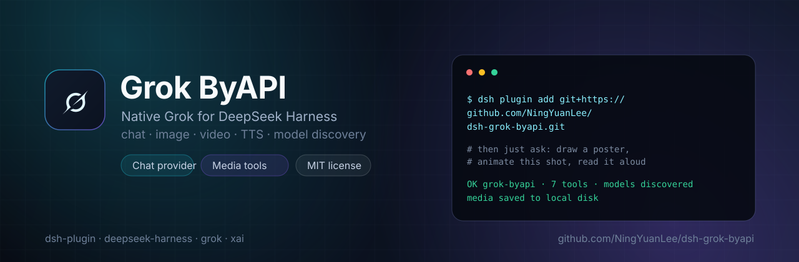
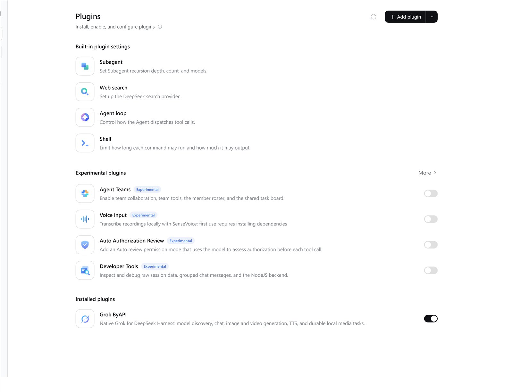
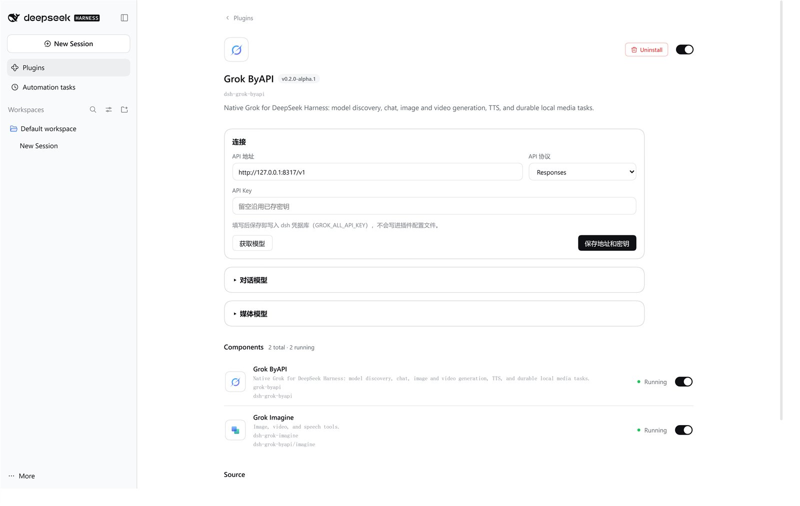

# dsh-grok-byapi

Native Grok for DeepSeek Harness: a chat provider plus image, video, and TTS tools over your own OpenAI-compatible Grok gateway.

[](https://github.com/NingYuanLee/dsh-grok-byapi/actions/workflows/ci.yml) [](LICENSE) [](#compatibility) [](#compatibility) [](https://github.com/topics/dsh-plugin) [](https://github.com/NingYuanLee/dsh-grok-byapi/tags)

English | [中文](README.zh.md)

> **`0.2.1` on npm `latest`.** Chat routing still depends on the dsh `0.2.1-rc.2` adapter registration; rerun integration tests after a host upgrade. See [VALIDATION.md](VALIDATION.md).

One plugin, one gateway connection. Chat models appear in the model picker; image, video, and TTS models stay out of it and are used through tools instead. Any chat model — Grok or another provider — can call those tools. The plugin talks to a Grok gateway you already run (CLIProxyAPI by default), keeps the API key in the dsh credential service, and saves generated media locally. It is not an OAuth client, does not provide an account or quota, and does not read the Grok CLI OAuth token.

## Demo

| Plugins page | Settings page |
| --- | --- |
|  |  |

Both stills below were generated by this plugin with `grok_generate_image` and `grok-imagine-image-2.0`. They are not composited afterward:

| Cool still | Warm still |
| --- | --- |
|  |  |

This GIF is a 4-second `grok_generate_video` clip. It is not a frame-by-frame animation of the still above:


## Features

| Area | Current scope |
| --- | --- |
| Chat provider | Registers a native dsh LLM provider: route `xAI-CLIProxyAPI`, display name **Grok**. Streaming text and tool calls go through the official pi-ai adapter. |
| Model catalog | `GET /models` discovery, auto-categorized as chat, image, video, speech, research, or unknown. Only chat models enter the picker; unknown models do not. Per-model overrides are available. |
| Settings page | Connection, API key, verification, timeout, the chat-model table (the picker's source of truth), and media-model selection. Copy follows the dsh language (English or Chinese). |
| Durable media tasks | Task records are per session and survive restarts. Downloads write `.part` files and are renamed after validation. Storage is isolated by connection and task. |
| Results in chat | Tool result cards, file preview, and a sidebar player for MP4, MP3, and WAV. Tool cards and the player follow the dsh language. |

Together, the plugin's two components register 10 tools. The plugin page has connection and model settings only. The grok-byapi detail lists chat and the catalog; the dsh-grok-imagine detail lists image, video, and speech:

| Tool | What it does |
| --- | --- |
| `grok_models` | Refreshes the catalog and returns models grouped by capability. Optional `verify_key` checks address and key with one `GET /models`. |
| `grok_generate_image` | Text to image: `prompt`, optional `model`, `n` (1–4, default 1). |
| `grok_edit_image` | Image to image: `prompt` plus `image_url` / `image_urls` (up to 5) or a saved image task. |
| `grok_generate_video` | Text to video, or image to video when one still (`image_url` or a saved image task) is attached. `duration` is 1–15 seconds, default 2. |
| `grok_edit_video` | Video to video: edit an existing video from a prompt (`video_url` or a saved video task). |
| `grok_extend_video` | Continues from the last frame and joins that to the original clip. |
| `grok_speak` | Text to speech saved as MP3: `input`, optional `model` and `voice`. |
| `grok_media_list` | Lists media tasks created in the current session. |
| `grok_media_status` | Checks a task and downloads the result when ready: `task_id`. |
| `grok_media_retry_download` | Retries a failed download without regenerating: `task_id`. |

Not provided: speech recognition, realtime voice, direct OAuth, and a live task dashboard. Video jobs are polled in-process after submit, but the result card does not refresh itself. Classification is rule-based, not a guarantee.

## Compatibility

| Component | Requirement | Verified |
| --- | --- | --- |
| dsh | `>=0.2.1-rc.2 <0.3.0-0` via `engines.dsh` | `0.2.1-rc.2` end to end (chat, image, video, TTS, playback) |
| Node.js | `>=22.19.0` | Node 24 on Windows; CI runs Node 22.19 and 24 on Linux and Windows |
| Gateway | OpenAI-compatible `/v1` endpoint; CLIProxyAPI recommended | CLIProxyAPI v8.0.30 |
| Other dsh 0.2.x | Inside the `engines.dsh` range | Not individually verified |

`engines.dsh` is the compatibility gate; `peerDependencies` pin the SDK packages the source uses but do not decide compatibility, so rerun the integration tests after a dsh upgrade. A direct xAI or other compatible endpoint can serve chat, but image, video, and TTS need the gateway to expose the matching Grok endpoints.

## Install

**From npm (recommended):**

```powershell
dsh --profile grok-byapi-test --from-default-profile web --dump-config
dsh plugin --profile grok-byapi-test add dsh-grok-byapi
```

That installs the current `latest`, which is `0.2.1`.

**From git, pinned to a tag:**

```powershell
dsh --profile grok-byapi-test --from-default-profile web --dump-config
dsh plugin --profile grok-byapi-test add "git+https://github.com/NingYuanLee/dsh-grok-byapi.git#v0.2.1"
```

`--dump-config` creates the profile from your default profile and prints the merged configuration without starting a server. `dsh plugin add` records the bundle in that profile — no manual YAML edit. The package has no `prepare` or `postinstall` script, so installation runs no build code and needs no `allowBuilds` entry.

**From a GitHub Release tarball (once the release is published):**

```powershell
dsh plugin --profile grok-byapi-test add "https://github.com/NingYuanLee/dsh-grok-byapi/releases/download/v0.2.1/dsh-grok-byapi-0.2.1.tgz"
```

**From local source (development):**

```powershell
git clone https://github.com/NingYuanLee/dsh-grok-byapi.git
cd dsh-grok-byapi
npm install --ignore-scripts
dsh --profile grok-byapi-test --from-default-profile web --dump-config
dsh plugin --profile grok-byapi-test add "$PWD"   # bash/zsh: "$(pwd)"
```

Start dsh with that profile:

```powershell
dsh --profile grok-byapi-test --no-open
```

Keep the plugin in a dedicated profile until you are satisfied; this keeps the provider, tools, and settings out of your daily environment. For a fully isolated trial, point `DSH_HOME` at a scratch directory.

## Update and uninstall

Updating a tag-pinned git install means removing it and adding the new tag; local installs update with `git pull` and `npm install --ignore-scripts`; tarball installs are removed and replaced with the new `.tgz`. Restart dsh afterwards.

```powershell
dsh plugin --profile grok-byapi-test remove dsh-grok-byapi
```

Removing the plugin takes its layer out of the profile: the provider, the 10 tools, and its settings page are gone. Generated media and task records are not deleted — remove the data directory yourself if you want them gone. A credential created for the plugin is also not removed by uninstall; delete it in dsh if you no longer need it.

## Configuration

Use the plugin settings page for normal setup. Manual configuration in the profile's `cordis.patch.yml` is possible but optional:

```yaml
- id: grok-byapi
  name: dsh-grok-byapi
  config:
    connection:
      baseURL: http://127.0.0.1:8317/v1
      api: openai-responses
      apiKeyEnv: GROK_ALL_API_KEY
      timeoutMs: 60000
    media:
      imageModel: grok-imagine-image-2.0
      videoModel: grok-imagine-video-1.5
      speechModel: grok-tts
      dataDir: ''
```

| Key | Default | Notes |
| --- | --- | --- |
| `connection.baseURL` | `http://127.0.0.1:8317/v1` | Gateway base URL. `127.0.0.1` is the machine running dsh; use your own HTTPS URL for a remote gateway. |
| `connection.api` | `openai-responses` | Chat protocol; `openai-completions` is the alternative. |
| `connection.apiKey` | empty | Direct key override for local testing; takes precedence over the credential. Leave empty in normal use. |
| `connection.apiKeyEnv` | `GROK_ALL_API_KEY` | Credential reference name in the dsh credential service. |
| `connection.verify` | `true` | Verify `GET /models` with the saved key when settings are saved. |
| `connection.timeoutMs` | `60000` | Request timeout in milliseconds (1000–600000). |
| `media.imageModel` | empty | Image model used when a call omits `model`. |
| `media.videoModel` | empty | Video model used when a call omits `model`. |
| `media.speechModel` | empty | TTS model used when a call omits `model`. |
| `media.dataDir` | empty | Media output directory; empty means `$DSH_HOME/plugins/dsh-grok-byapi`. |
| `modelOverrides` | `[]` | Per-model overrides written by the settings page: category, display name, image support, context window, max output, reasoning efforts. Applied on the next refresh. |

The settings page writes the API key into the dsh credential service under the reference name above; the configuration keeps only the reference. Do not hand-write a key into YAML. The media model IDs in the example come from the test gateway — run `grok_models` and use the IDs your gateway reports.

## Security and privacy

- **Network:** only the gateway you configure. Discovery calls `GET /models`, chat uses the configured OpenAI-compatible route, and media tools call image, video, and TTS endpoints on the same base URL. No telemetry.
- **Credentials:** the key lives in the dsh credential service; it is not written to YAML, logs, task records, or the repository. Third-party media downloads are requested without the gateway key.
- **Files:** generated media goes to `$DSH_HOME/plugins/dsh-grok-byapi` (or `media.dataDir`). Task records may contain signed upstream URLs; treat them as private.
- **Not done by this plugin:** reading or reusing the Grok CLI OAuth token, installing or running other plugins, fetching runtime dependencies at install time.

Installing any dsh plugin runs third-party code with your user permissions, and tool approvals do not sandbox plugin code — review the source before installing. Please report security issues through [SECURITY.md](SECURITY.md).

## Usage

- **Chat:** choose **Grok** in the model picker. Only chat models are listed; the settings page's model table is what the picker shows, so delete a row and save to hide that model.
- **Images:** one call generates and saves; inline the result with an absolute local path — ``. dsh Web serves it through `/api/file`; the limit is 20 MiB per file.
- **Video:** submits a job (1–15 s). Call `grok_media_status` with the returned `task_id` until `saved` or `failed`; `submission-unknown` means do not submit again. There is no automatic polling or completion notification.
- **Speech:** `grok_speak` writes an MP3; `grok_media_retry_download` retries only the download and never regenerates.
- **Display:** video and audio appear in the tool result card player. Do not inline them with Markdown image syntax — the chat does not render them and shows a broken image instead.

## Troubleshooting

Installation is successful when all four checks pass:

1. `dsh --profile grok-byapi-test --dump-config` lists the `grok-byapi` layer.
2. The Plugins page shows this plugin with both components (the provider and `dsh-grok-imagine`) running.
3. `grok_models` returns categorized model IDs.
4. After `dsh plugin --profile grok-byapi-test remove dsh-grok-byapi`, the layer and components are gone.

| Symptom | Fix |
| --- | --- |
| `dsh plugin add` fails or reports 404 | Install `dsh-grok-byapi@0.2.1` from npm, or use the git / tarball path above. |
| Plugin is listed but does not load | Your dsh is outside `>=0.2.1-rc.2 <0.3.0-0`. Upgrade to a 0.2.x build. |
| 401 or 403 in settings | Wrong key or base URL. Re-save the key and check the `/v1` suffix. |
| Connection refused or timeout | Gateway not running or unreachable; `127.0.0.1` means the dsh host. |
| No Grok models in the picker | `/models` returned nothing classified as chat; refresh `grok_models` and add overrides. |
| Model not discovered or wrong category | Refresh `grok_models`, then correct the category in the settings page. |
| Image, video, or TTS fails while chat works | The gateway does not expose the matching Grok endpoints; the plugin cannot add them. |
| Video stays generating | Query `grok_media_status`; do not resubmit a `submission-unknown` task. |

More measured behavior and limits: [VALIDATION.md](VALIDATION.md).

## Development

```bash
npm install --ignore-scripts
npm test             # 70 automated tests
npm run check        # syntax checks for the source files
npm run build        # rebuilds lib/client.js from src/client.js
npm pack --dry-run
```

CI (`.github/workflows/ci.yml`) runs on Linux and Windows with Node 22.19 and 24: install, tests, syntax checks, build, a check that `lib/client.js` matches the build output, and a pack dry run. Pushing a `v*` tag runs `.github/workflows/release.yml`, which verifies that the tag matches `package.json`, repeats the checks, attaches the packed tarball to a GitHub Release, and publishes to npm only if an `NPM_TOKEN` secret is configured. npm publishing is currently blocked, so releases are git/tarball only. See [ROADMAP.md](ROADMAP.md) for planned work and [CHANGELOG.md](CHANGELOG.md) for changes.

## Community, license, and disclaimer

- Bugs and feature requests: [Issues](https://github.com/NingYuanLee/dsh-grok-byapi/issues) (bug report and feature request templates are provided).
- Security: [SECURITY.md](SECURITY.md) — please use GitHub's private vulnerability reporting.
- License: [MIT](LICENSE). Copyright (c) 2026 NingYuanLee.
- Repository: <https://github.com/NingYuanLee/dsh-grok-byapi>. This is a community plugin project, not an official DeepSeek or xAI product. "ByAPI" means the plugin reaches Grok through your own API gateway; it does not implement every Grok web feature.